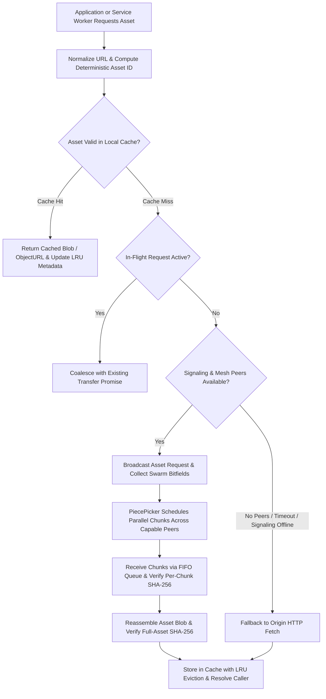

# ShadowCast

**A battle-tested, decentralized client-side P2P mesh network engine that mirrors and streams static web assets directly browser-to-browser over WebRTC DataChannels.**

ShadowCast turns active website visitors into a collaborative caching edge network. By streaming static assets (images, video segments, WebAssembly binaries, 3D models, fonts, and bundles) across connected peers with cryptographic integrity verification, ShadowCast reduces origin server bandwidth, lowers CDN egress costs, and accelerates asset delivery with automatic HTTP origin fallback.

## Key Capabilities

- **Glare-Free WebRTC DataChannel Mesh**: Deterministic peer-to-peer connection negotiation (`localPeerId < remotePeerId`), automatic ICE candidate queuing prior to remote SDP description setup, and resilient connection lifecycle management.
- **Load-Balanced Multi-Peer Swarm Piece Picker**: Torrent-inspired parallel chunk scheduling that verifies per-peer bitfield availability, distributes chunk requests evenly across active seeders, and automatically reassigns in-flight chunks if a peer disconnects mid-transfer.
- **End-to-End SHA-256 Cryptographic Integrity**: Hardware-accelerated Web Crypto `SHA-256` verification (backed by a spec-compliant FIPS 180-4 pure-TypeScript fallback for non-secure contexts and headless runtimes) across both individual binary chunks and reassembled `Blob` payloads.
- **Fault-Tolerant Origin Fallback & Request Coalescing**: Seamless degradation to standard HTTP `fetch()` whenever no peers are available, a P2P transfer times out, or the signaling server is unreachable. Concurrent requests for the same asset URL are automatically coalesced into a single in-flight transfer.
- **Persistent IndexedDB & Memory Caching**: Cross-session storage engine with configurable LRU byte limits, maximum entry caps, TTL expiration, non-mutating existence checks, and automatic `ObjectURL` lifecycle revocation.
- **Zero-Code Service Worker Interception**: Transparent `fetch` interception for static assets (including URLs with query parameters) using `MessageChannel` streaming and runtime pattern configuration.
- **Production Go Signaling Server**: Lightweight WebSocket signaling backend featuring client peer ID synchronization, room transition cleanup, token-bucket rate limiting, Ping/Pong heartbeat deadlines, Prometheus metrics (`/metrics`), and health/readiness probes (`/healthz`, `/ready`).

## System Architecture



## Repository Structure

| Path | Description |
| :--- | :--- |
| `library/` | Core TypeScript P2P WebRTC asset delivery engine (`shadowcast` npm package) |
| `library/src/core/` | `ShadowCast` orchestrator facade, typed `EventEmitter`, and core interfaces |
| `library/src/cache/` | `CacheManager`, `IndexedDBCache`, `MemoryCache`, and `LRUPolicy` eviction engine |
| `library/src/mesh/` | `MeshManager` topology controller and `PeerConnection` WebRTC wrapper |
| `library/src/transfer/` | `ChunkSender`, `ChunkReceiver` (FIFO queue & SHA-256 verification), and `PiecePicker` |
| `library/src/signaling/` | `SignalingClient` WebSocket transport with connection timeouts and isolation |
| `library/src/interception/` | `ServiceWorkerManager` and `sw.ts` transparent fetch interceptor |
| `library/src/utils/` | Web Crypto + FIPS 180-4 `SHA-256` hashing, URL normalization, and RFC-4122 UUIDs |
| `library/src/__tests__/` | Unit and end-to-end integration test suites (30 tests across 10 test files) |
| `signaling/` | Go WebSocket signaling server with rate limiting, metrics, and `main_test.go` |
| `demo/` | Next.js 14 App Router live mesh topology dashboard and interactive API playground |
| `docker-compose.yml` | Multi-container stack orchestrating `signaling`, `coturn` TURN relay, and `demo` |

## Installation & Quickstart

### 1. Run Full Stack with Docker Compose

Launch the Go signaling server, `coturn` STUN/TURN relay, and Next.js visualization dashboard:

```bash
git clone https://github.com/assishmoncs/shadowcast.git
cd shadowcast
docker compose up --build
```

| Service | Endpoint | Description |
| :--- | :--- | :--- |
| **Live Mesh Dashboard** | `http://localhost:3000` | Real-time 2D canvas topology visualizer and swarm gallery |
| **API Playground** | `http://localhost:3000/playground` | Interactive workbench for testing API calls and live events |
| **Signaling WebSocket** | `ws://localhost:8080/ws` | WebRTC SDP & ICE signaling endpoint |
| **Readiness Probe** | `http://localhost:8080/ready` | JSON server telemetry, room counts, and uptime |
| **Prometheus Metrics** | `http://localhost:8080/metrics` | Prometheus-formatted counters and gauges |

### 2. Install the Library

```bash
npm install shadowcast
```

## Programmatic Usage

### Basic Client Setup

```typescript
import { ShadowCast } from 'shadowcast';

const sc = new ShadowCast({
  signalingUrl: 'ws://localhost:8080/ws',
  defaultRoom: 'global-media-swarm',
  chunkSize: 64 * 1024, // 64 KB chunks
  p2pTimeout: 5000,     // Fallback to HTTP after 5s if swarm transfer stalls
  peerWaitTimeout: 1500,
  verifyIntegrity: true,
  cache: {
    driver: 'indexeddb',
    maxSizeBytes: 250 * 1024 * 1024, // 250 MB LRU budget
    maxEntries: 500,
    ttlMs: 7 * 24 * 60 * 60 * 1000,  // 7 days
  },
});

// Connect to signaling room (optional: requestAsset auto-connects and degrades to HTTP if offline)
await sc.connect('global-media-swarm');

// Request an asset as a DOM ObjectURL (resolved via Cache -> P2P Swarm -> HTTP Origin)
const objectUrl = await sc.requestAsset('https://example.com/assets/hero-banner.webp?v=2');
document.querySelector<HTMLImageElement>('#hero')!.src = objectUrl;

// Or request the raw Blob directly
const blob = await sc.requestAssetBlob('https://example.com/models/scene.glb');
```

### Zero-Code Service Worker Interception

```typescript
// Register the Service Worker with optional custom URL matching rules
await sc.registerServiceWorker('/sw.js', {
  scope: '/',
  includePatterns: [/\.(png|jpe?g|webp|avif|mp4|webm|wasm|woff2?)(\?.*)?$/i],
  excludePatterns: [/\/api\//i, /analytics/i],
  timeoutMs: 8000,
});
```

### Real-Time Telemetry & Events

```typescript
const unsubscribeJoin = sc.on('peer:join', ({ peerId, totalPeers }) => {
  console.log(`Peer ${peerId} connected (Active swarm peers: ${totalPeers})`);
});

sc.on('transfer:progress', ({ url, percent, bytesReceived, totalBytes }) => {
  console.log(`Streaming ${url}: ${percent}% (${bytesReceived}/${totalBytes} B)`);
});

sc.on('transfer:complete', ({ url, source, durationMs, bytes }) => {
  console.log(`Resolved ${url} (${bytes} B) via ${source.toUpperCase()} in ${durationMs}ms`);
});

sc.on('bandwidth:saved', ({ bytes, cumulativeBytes }) => {
  console.log(`Saved ${bytes} B on this transfer (Total saved: ${cumulativeBytes} B)`);
});

// Inspect live snapshot metrics at any time
console.log(sc.stats);
// {
//   peersCount: 3,
//   isConnected: true,
//   cumulativeBandwidthSaved: 4194304,
//   totalP2PBytes: 4194304,
//   totalHttpBytes: 1048576,
//   cacheHits: 12,
//   transfersCount: 15
// }
```

## Configuration Reference

### `ShadowCastConfig` Options

| Option | Type | Default | Description |
| :--- | :--- | :--- | :--- |
| `signalingUrl` | `string` | `'ws://localhost:8080/ws'` | WebSocket URL of the ShadowCast signaling server |
| `defaultRoom` | `string` | `'shadowcast-global'` | Default room joined when `connect()` is called without arguments |
| `iceServers` | `RTCIceServer[]` | Google STUN servers | STUN/TURN ICE servers passed to `RTCPeerConnection` |
| `chunkSize` | `number` | `65536` (64 KB) | Byte size of each binary slice streamed over WebRTC DataChannels |
| `p2pTimeout` | `number` | `5000` (5s) | Maximum time (ms) to wait for P2P chunk completion before HTTP fallback |
| `peerWaitTimeout` | `number` | `1500` (1.5s) | Maximum time (ms) to wait for an open DataChannel before HTTP fallback |
| `verifyIntegrity` | `boolean` | `true` | Enables SHA-256 verification on each chunk and the reassembled asset |
| `cache.driver` | `'indexeddb' \| 'memory'` | `'indexeddb'` | Storage backend (automatically falls back to `'memory'` in non-DOM runtimes) |
| `cache.maxSizeBytes` | `number` | `262144000` (250 MB) | Maximum total cache size before LRU eviction |
| `cache.maxEntries` | `number` | `500` | Maximum number of cached assets before LRU eviction |
| `cache.ttlMs` | `number` | `604800000` (7 days) | Time-to-live (ms) before cached entries expire |

### Signaling Server Environment Variables

| Variable | Default | Description |
| :--- | :--- | :--- |
| `PORT` | `8080` | HTTP/WebSocket listening port |
| `ALLOWED_ORIGIN` | `*` (all origins) | Comma-separated list of permitted WebSocket `Origin` headers |
| `AUTH_TOKEN` | *(empty)* | Optional shared secret verified via `X-Auth-Token` header or `?token=` query |
| `RATE_LIMIT_PER_SEC` | `50` | Per-client token-bucket message rate limit (burst capacity is `2x`) |
| `MAX_ROOMS` | `1000` | Maximum concurrent active signaling rooms |
| `MAX_CLIENTS_PER_ROOM` | `100` | Maximum concurrent peers allowed in a single room |
| `READ_LIMIT_BYTES` | `65536` (64 KB) | Maximum incoming WebSocket frame payload size |

## Building & Testing

### TypeScript Library (`library/`)

Build the ESM distribution and execute the complete unit and end-to-end test suite:

```bash
cd library
npm run build
npm test
```

The test suite covers:
- **Cryptographic Hashing & URL Normalization**: NIST SHA-256 test vectors, `Uint8Array` subview offsets, Web Crypto vs. pure-JS fallback parity, URL fragment stripping, and RFC-4122 v4 UUID generation.
- **Cache Engine & LRU Eviction**: Size/count bounds, in-place entry updates without false eviction, TTL expiration, and `ObjectURL` management.
- **Chunk Transfer & Swarm Scheduling**: Multi-chunk slicing, MIME preservation, 0-byte `Blob` edge cases, corrupted chunk SHA-256 rejection and recovery, and partial-bitfield load balancing in `PiecePicker`.
- **WebRTC Mesh & Signaling**: Pre-`remoteDescription` ICE candidate queuing/flushing, deterministic glare-free offer initiation, and `waitForPeers` cleanup resolution.
- **End-to-End Multi-Peer Simulations**: Full virtual WebSocket + WebRTC DataChannel swarm transfers, 3-peer parallel chunk distribution, P2P timeout fallback, signaling outage degradation, and concurrent request coalescing.

### Go Signaling Server (`signaling/`)

Run the Go unit and WebSocket relay integration tests:

```bash
cd signaling
go test -v ./...
go build -v .
```

## License

MIT © ShadowCast Contributors
